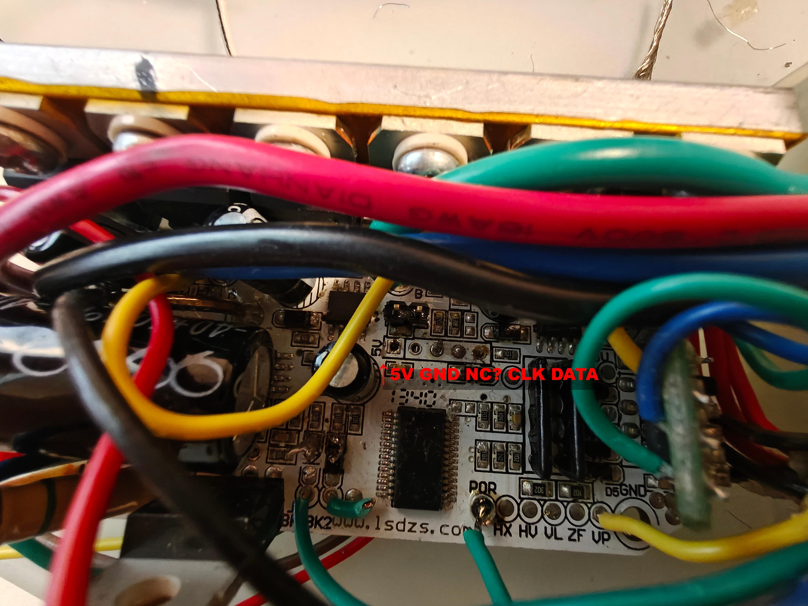
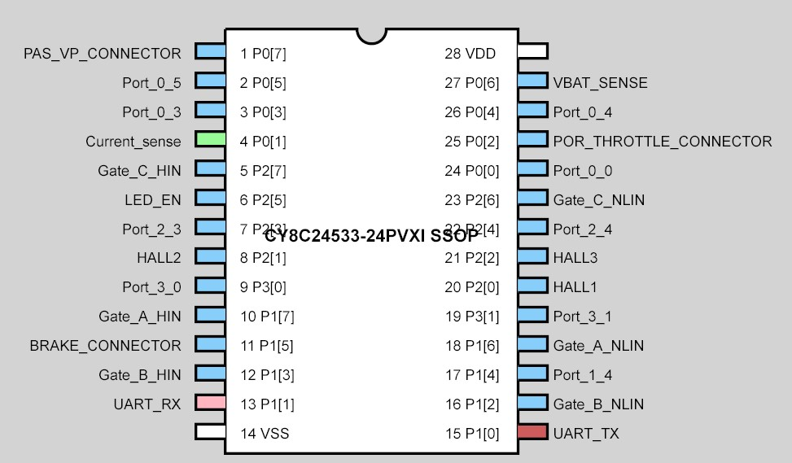

# Custom firmware for Lishui E-Bike Controller LSW 1275-8F with Cypress CY8C24533. PSoC Designer 5.4
Synchronous BLDC with partial sine PWM, second phase pulled low, third phase floating. 
The code uses hall sensors, the ESC is sensorless. There is an addon PCB with another Cypress Chip on that simulates the 3 hall signals from back-EMF. The firmware of the addon-PCB is not modified. 

The original Lishui firmware could not be read out, so this is not based on the original functionality. On this firmware the motor is controlled by ADC / Throttle (POR Connector) under the condition that PAS (VP Connector) is active and brake (BK Connector) is pulled high. It can also be controlled via UART instead.

Current calculation from the shunt is inaccurate, it should be measured and adjusted. 
Edit parameters in config.h

### Lishui Debug Pinout

### MCU Pinout (Cypress)

