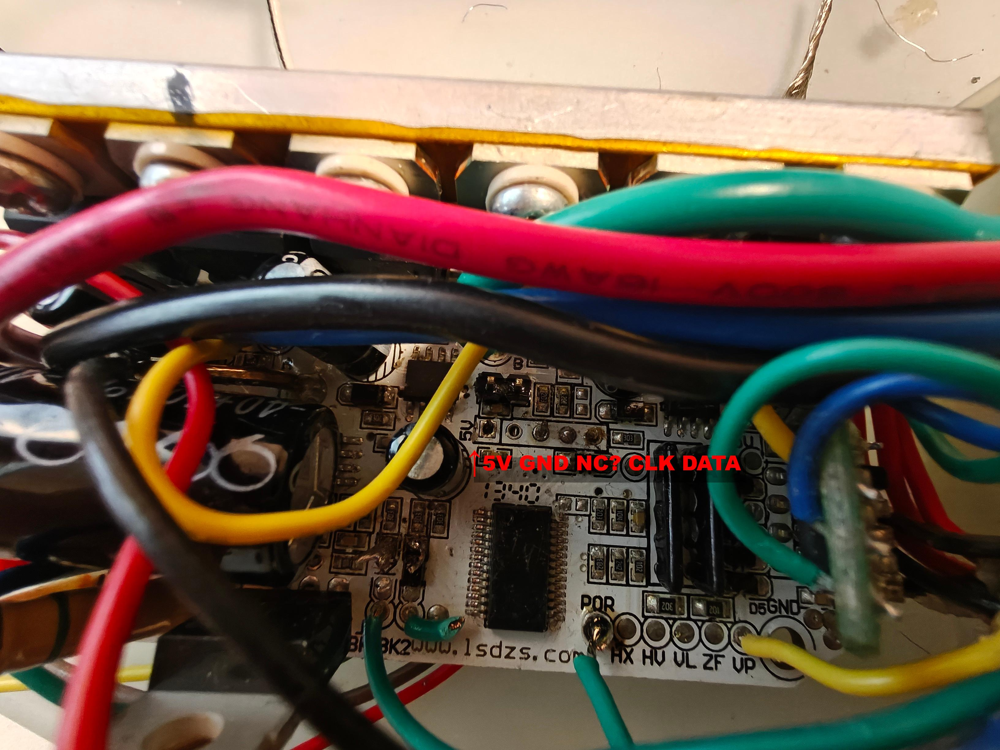
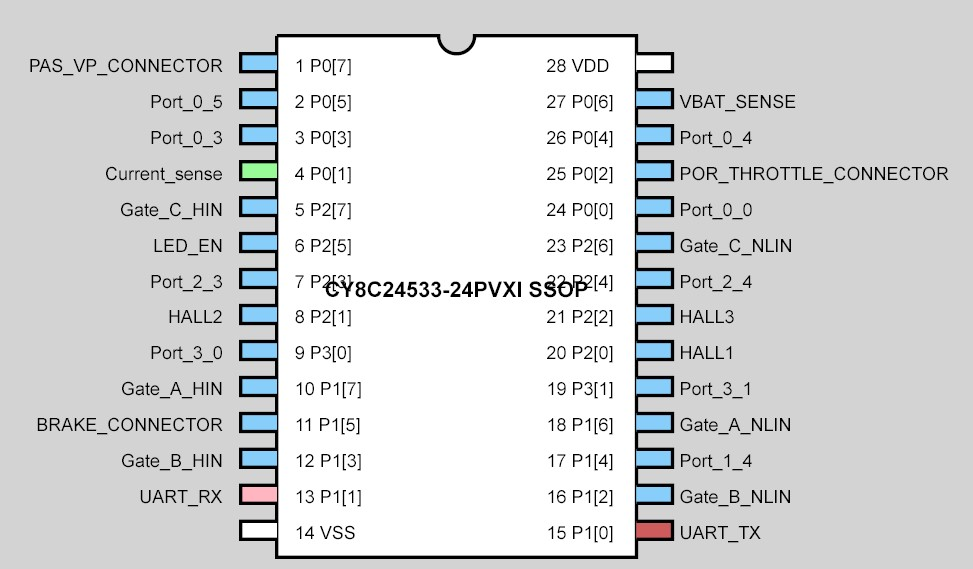

# Custom firmware for Lishui E-Bike Controller LSW 1275-8F with Cypress CY8C24533. PSoC Designer 5.4
Synchronous BLDC.
The code uses hall sensors, the ESC is sensorless. There is an addon PCB with another Cypress Chip on that simulates the 3 hall signals from back-EMF. The firmware of the addon-PCB is not modified. 

The original Lishui firmware could not be read out, so this is not based on the original functionality. On this firmware the motor is controlled by ADC / Throttle (POR Connector) under the condition that PAS (VP Connector) is active and brake (BK Connector) is pulled high. It can also be controlled via UART instead.

Current calculation from the shunt is inaccurate, it should be measured and adjusted. 
Edit parameters in config.h

### UART
The UART (19200 baud, P1[0] TX / P1[1] RX on the debug header) uses the binary protocol by default (`USE_BINARY_COMM 1` in config.h; 0 gives the old text terminal). Without anything connected the controller drives from its own throttle / PAS / brake inputs. An ESP32 running [esp32_control](esp32_control) switches the command source to external and sets the current from the same inputs; if it stops answering, the controller takes over again after 125 ms. The brake cuts the current in both modes. Protocol: see `comm_binary.c` or [esp32_control/src/lishui_link.h](esp32_control/src/lishui_link.h).

`LishuiTest1/LishuiTest1.hex` is the build of these sources.

### Lishui Debug Pinout

### MCU Pinout (Cypress)

